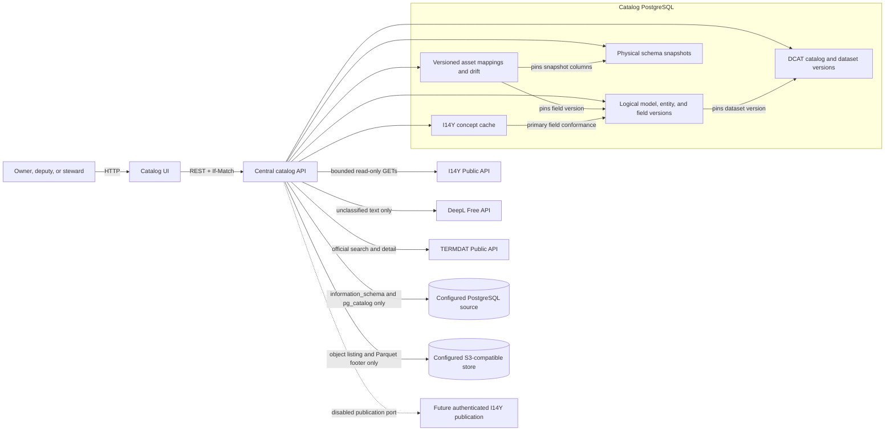
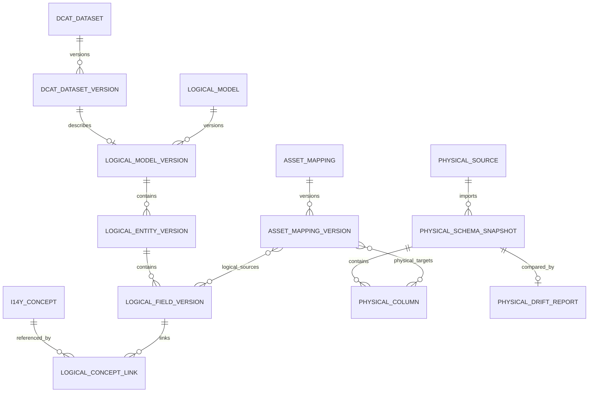

# Logical models, I14Y concepts, physical models, and mappings

Physical source metadata imports use a bounded 60-second client request budget, independently
of the ordinary eight-second reads. Revision and identity checks remain in force. The source
stays in its loading state until confirmed success or a failure, including longer drift checks;
the browser regression checks the success notice before verifying the new immutable snapshot.

## UI terminology

**Mapping** is the language-independent name for the logical-to-physical workspace section,
including DE/FR/IT/EN. Use **Mapping hinzufügen**, **Mapping bearbeiten**, **Mapping übernehmen**
and **Mappings** for plural references. The model tab stays singular **Mapping** in every
language. This terminology concerns asset mappings; generic domain/role responsibility
assignments are separate concepts. Technical route names, IDs and persisted history are unchanged.

Physical search uses the generic **Data Structure** concept for tables, views and structured
S3 objects/datasets; concrete result icons and types remain specific to the representation.
Physical-field parent links use the same generic concept. This terminology does not rename
persisted physical table/object metadata or mapping references. See [expert-search contexts](expert-search.md#storage-neutral-search-contexts).

## Mapping entry and recent work

**Mapping-Arbeitsplatz** on `/models` opens `/mappings`, with two compact logical/physical
choices. Selecting a logical model immediately opens `/models/:id/mappings`. Selecting an object
in the physical picker immediately opens `/mappings/physical/:snapshotId/:tableId`, with that
exact representation in the real mapping canvas and a logical-counterpart selection action.
There is no second **Mapping öffnen** confirmation. This physical-only start does not fabricate
a logical model, create mappings or persist membership. Its URL preserves the physical selection
on reload; model-based PostgreSQL recents begin once a logical model is opened.

Model search initially shows eight matches, with more available. Lists stay closed until
requested. The physical selection dialog is compact and opens an object on click; the normal
attachment dialog still inspects the object and requires **Hinzufügen**. Choosing a logical
counterpart in the physical canvas checks model-specific source permissions and automatically
opens the pair. An incompatible selection remains visible with an explanation and no write.
Small blue indicators show pending model, physical structure, source and history reads. Model
and history reads are independent. On small screens the physical object uses the canvas width
and the counterpart action appears in the toolbar; desktop retains the empty logical-side card.
A logical model without a physical representation offers a visible **Physische Repräsentation
auswählen** action for authorized editors, alongside the existing canvas context menu.

A chosen counterpart opens `/models/:id/mappings?physicalSnapshotId=…&physicalTableId=…&addRepresentation=1`.
That exact object becomes a local editable representation when not already bound. No field
mappings or bindings are automatically saved. Explicit **Entwurf speichern** and unsaved-work
navigation protection remain active. Existing `suggest=1` links keep their separate name-pair
suggestion behavior. Legacy `/mappings?logicalModelId=…` forwards with query context; physical-
snapshot-only links offer that snapshot's objects for selection. **Andere Modelle auswählen**
returns to the entry page. Unavailable model-scoped links never open a different first model.

**Letzte Mapping-Arbeiten** shows five entries and optionally up to ten, newest first, with one
entry per logical model/user. Current title, physical context and visit time distinguish them;
**Fortsetzen** restores the available exact model/object/view. This is navigation context;
unsaved logical/mapping/layout drafts are not recovered.

`GET /api/v1/me/mapping-workspaces` reads private history; `PUT …/:modelId` records a successfully
opened/selected context. Existing authenticated modeling dependencies supply the actor, never
the body. Reads reauthorize model and source access; inaccessible/retired models are omitted,
and unavailable physical references are stripped while accessible logical models remain.
Writes validate the physical object against its exact snapshot. Responses are private/no-store.
Background refresh and fallback fixtures never create recent-work entries.

Migration `0045_mapping_workspace_visits` persists personal context separately from expiring
login sessions, shared canvas layout and immutable catalog evidence. User-row locking serializes
updates/pruning to ten entries; browser writes are queued in interaction order. Neither history
reads nor writes create catalog versions, bindings, audit events or access grants. A history
failure leaves the workspace usable and reports that the recent-work entry was not saved.
Finite queued history writes finish when leaving the workspace rather than being cancelled by
route destruction; API timeouts still apply. Successfully saving field or mapping edits updates
recency even when the selected object/view stays the same.

## Visible physical bindings and automatic refresh

**Repräsentationen dieses Modells** and the graph both use the facade's visible representation
set, including draft attachments and explicitly opened drift previews. Hiding a physical card
immediately removes it from both displays. **Ausgeblendete einblenden** restores hidden cards;
it does not reimport structures or create bindings. Empty memberships and immutable historical
mappings retain their existing storage semantics. Hiding is a local display choice.

Both the list and graph show **Mit Quellenanbindung** when the catalog confirms a configured
PostgreSQL/S3 source connector, or **Nur Strukturmetadaten** without a technical connection
(including declared CSV inventories and fixtures). Legacy responses without a confirmed flag
show **Anbindung unbekannt** rather than inferring a working endpoint from a type or path.
`sourceConnectionConfigured` is a read projection of the trusted adapter/configuration reference;
neither its reference nor credentials are needed in this indicator. A configured connector does
not prove reachability or a published/authorized product-delivery endpoint.

An idle, visible workspace reads model, mappings, representations, snapshot options, imported
structures and shared canvas layout every five seconds and when focus/visibility returns.
The snapshot overview reads only metadata summaries rather than loading every table/column;
structure details are fetched for the workspace's referenced snapshots.
Only one refresh runs at a time. Responses from earlier identities, selections or saves cannot
replace newer work. Existing field selection, hidden cards, graph/table/drift mode and fullscreen
are retained. Missing/inaccessible snapshot details are omitted without failing healthy cards.
Temporary read failures retain the confirmed catalog state, show a notice and retry; they never
switch to demo fixtures. A revoked/missing model clears its displayed content.

Local model/mapping/layout drafts, pending connections and open editors pause automatic
replacement and show a notice. Saving or reloading permits refresh again; explicit reload still
asks before discarding local work. Imported structure changes become visible after the catalog
has recorded a new snapshot; DaCa does not continuously inspect external databases or files.

## Authorization audit follow-up

Migration `0043_deputy_steward_role` allows all four modeling roles. Active deputy stewards
share scoped operational capabilities, while publication requires the model's named owner or
named delegated deputy. An owner's delegation alone does not authorize every one of their
models. Domain review decisions recheck current active domain owners/deputies, exclude the
submitter and retain the existing revision/row locks. `canDecide` is server-computed; historical
reviewer IDs are descriptive. Identity changes clear pending review reads in the UI.

This does not complete object-level authorization for this module: version/source scope guards
remain broad, model ownership still follows domain normalization in older paths, and some
mapping decisions still require the primary owner. These are tracked explicitly in the
[authorization audit](authorization-consistency-audit.md), rather than being interpreted as
LDS/ALDS authority.

## Shared mapping canvas positions

Term/domain canvases additionally support hold-to-create/search and staged card hiding. Their
reference cards do not add logical/physical model mappings or change domain membership; see
[semantic diagrams](domains-and-glossary.md). Model-card quick dragging retains its existing
mapping-workspace behavior.

Mapping graph context menus also open the shared catalog-object search for terms, domains,
logical models and accessible physical models. Search is navigation, not an implicit new mapping
or representation. Read-only users retain search access; mutation actions remain disabled.

The workspace loads `GET /api/v1/logical-models/{id}/canvas-layout` with its model and
representations. One central arrangement belongs to the model root, shared across people,
browsers and logical-model revisions. Node keys are `logical` and `physical:<table UUID>`;
physical cards remain pinned to their representation's exact snapshot/table. Missing positions
use the existing automatic arrangement. Hiding a drawing stays local and does not remove its
saved position, representation or mappings.

Owners/stewards in the model's organization can drag cards or move them with arrow keys.
Moves become local workspace changes, enable **Entwurf speichern**, and participate in the
unsaved-navigation warning. Saving supplies optional `canvasLayout: {revision, positions}` to
the existing atomic mapping-drafts endpoint. The backend validates finite bounded coordinates,
node membership and source access, locks the model root, checks the layout revision and commits
layout, model, representation, mapping and audit changes together. A conflict returns 409 and
keeps the local draft. Layout-only changes do not change logical-model or mapping versions.
Readers cannot reposition shared cards.

Positions for inaccessible/returned sources are omitted from responses and cannot be submitted.
Partial updates preserve their stored positions. Seeds never rewrite the layout. Other authorized
readers receive the latest arrangement on opening/reloading and through the five-second workspace
refresh above. This uses HTTP reads, without a separate push protocol.

## AdA physical-model import journey

Journey 14, **Import physisches Datenmodell – AdA**, lives at
`/documentation/journeys/import-physical-model-ada`, with a searchable tile in the journey index,
role, prerequisites, outcome, repeatability and six actionable steps. Its three-dot menu belongs
to that tile as a sibling of the navigation link, avoiding nested interactive elements.
The same component is also available in the AdA detail header beside duration and difficulty.
Both placements use the same download, authorization, confirmation and scoped reset; successful
resets navigate to the fresh importer. Other journey detail headers do not offer AdA actions.
The models and sources pages expose their CSV importer without journey controls.
It provides **AdA-Beispielinventar herunterladen** and **AdA-Import zurücksetzen**. Reset first
loads the example for a chosen authorized organization, displays its persisted name and explains
permanent structure removal and reference guards. Cancellation makes no mutation. Success opens
a fresh sources page and blank CSV importer in that same organization. Changing identity
or scope invalidates pending responses; an in-flight reset cannot be submitted twice or cancelled.

Journey start/reset navigation uses `importCsv=1&organizationId=…`. The importer waits for the
requested authorized scope, opens after render and consumes these query parameters with
replacement navigation. Reloading the sources page therefore does not reopen the popup.

`GET /api/v1/import-journeys/ada/inventory.csv` serves the versioned, packaged metadata example
to modeling actors. `GET /api/v1/import-journeys/ada` resolves the source from `departmentCode`
and `organizationId` with current scoped owner/steward authorization. `POST …/ada/reset` accepts
that scope and the displayed source revision as `If-Match`. The server computes the source ID
from its own CSV fingerprint, serializes against import and calls the shared inventory removal
service. Missing examples are an idempotent success; references and stale revisions are errors.
The local CLI `npm run journey:ada:reset -- --demo-user christian.man --yes` uses those same
HTTP endpoints through a local demo session. Without `--yes` it only previews the target.

The journey endpoints prefer the authenticated local session cookie, so a normal download link
works without custom headers. A conflicting demo header cannot override the session identity;
an invalid session does not fall back to a header. Header-only clients retain the existing
demo-auth boundary when no cookie is present. All journey endpoints require demo auth to be
enabled and recheck the actor's active roles. With multiple scopes, reset requires an explicit
organization choice instead of guessing from the order of role assignments.

Both the models overview and source register open the existing CSV importer. Its labelled drop
zone accepts exactly one CSV, shares file/size validation and stale-response protection with the
keyboard-accessible file picker, and performs preview only. Saving blocks further drops. The
user chooses the inventory name and organization, reviews table/field counts and imports before
the source and immutable snapshot are created. Cancellation does not persist metadata.

The [AdA model proposal](../examples/ada-bewirtschaftung/README.md) exercises this journey with
11 tables / 62 fields, PostgreSQL DDL, three fictional people and administrative records. It
covers person/status, assignment/rank history, organization, service/call-up/participation and
qualifications. Extra CSV declarations for PK/FK, defaults and nullability are preserved as
original records, rather than projected into verified snapshot constraints. The existing warning
about unknown CSV nullability remains accurate. Import does not execute SQL or load person rows.
No catalog migration or live Army connection is introduced. Persistent storage and example
boundaries are documented in [the data-model reference](data-model/ada-bewirtschaftung-example.md).

## Workspace context without duplicate selectors

The selection bar above dataset attributes has been removed, including the logical-model
dropdown, active-representation dropdown and visible-sources shortcut. Model/deep-link
resolution and saved membership loading remain intact. Representation cards select the active
snapshot and load its drift report; new representations use the existing canvas picker.
Users navigate between logical models through the model overview. The heading and dataset
attributes follow the current model context, including after an identity change.

## Relationship deletion is a draft edit

**Beziehung löschen** and **Verbindung entfernen** immediately hide the selected relationship
without a confirmation dialog. No HTTP mutation or audit event occurs at that point. New local
mapping drafts are discarded; persisted mappings enter `pendingRemovals`, retaining their ID,
version ID and optimistic lock. Counters, matrix, inspector and graph use the local removal;
refreshing mappings cannot bring a pending removal back. Navigation warnings include removals.
Reloading/discarding an unsaved workspace restores the stored relationship. Removing one target
from a multi-target mapping continues to use an ordinary local mapping revision.

The workspace save request accepts `removals` alongside model, representation and mapping edits.
Each removal checks model membership, current scoped owner/steward rights, physical-source access,
exact mapping version and lock. Duplicate removals or editing and removing the same mapping in
one request are rejected. A successful save appends an immutable `superseded` version with the
existing audit evidence; physical objects and fields remain intact. Any later failure rolls back
the complete transaction, and the UI retains its pending removals. Saving field characteristics
separately rebases pending removal locks without making their lines visible again.

## Live field-name preview and workspace save

The compact editor emits unsaved field changes with model/version identity on every form edit.
`MappingDraftFacade.logicalDraft` holds a local write DTO; `logicalFields` overlays its names
by stable field root ID. Saved model objects, field version IDs, mapping IDs and revisions remain
unchanged. Graph, matrix, inspector and mapping dialogs share this projection. Initial form
hydration does not emit a draft. The field panel stays mounted across Graph/Table/Drift switches
so its unsaved controls survive. Model/identity changes clear the projection; stale editor events
are ignored. Navigation/beforeunload protection includes pending logical changes.

**Entwurf speichern** is enabled for a logical-only draft. The existing workspace endpoint accepts
an optional `logicalModel` write beside mapping/representation changes. It applies the same scoped
role, owner and version checks as model editing; organization/domain changes use their existing
dialogs instead. One transaction saves mapping drafts, creates the logical successor, rebases all
surviving mapping references, synchronizes inconsistencies and commits. The response includes
the new logical model and current mappings filtered by source access, allowing the UI to replace
its preview with authoritative versions without losing the selected field. Any failure rolls back
the whole operation and retains the local form/draft. The separate field-save action still works.

## Move a field to another logical model

The field panel cannot rename its parent entity. A small magnifying glass beside **Entität**
opens a searchable list of other logical models (name, identifier, organization), followed by
the selected model's entities. Uneditable scopes and models in review are disabled. Entity-wide
renaming remains in the full model editor's separate entity section and updates every member.
Saved field data and local mapping drafts must be settled before a move.

The second dialog step names the field, source model/entity and destination model/entity. It
explicitly explains removal from the source, retention of mapping history without transferring
physical links, and the creation of two new drafts requiring review. The user must acknowledge
this warning and type the exact field name before **Feld jetzt verschieben** becomes available.
Cancellation does not write; errors retain the selection and show the server message.

`POST /logical-models/{model_id}/fields/{field_id}/move` accepts source/target version IDs,
target model ID and target entity root ID; actor identity comes from authentication. Both
model roots are row-locked in stable UUID order, then current Data Owner/Data Steward scopes
are checked independently for both models. Stale versions, review/retired models, a target
entity outside the target version, duplicate case-insensitive field names and removal of the
source model's last field are rejected. An emptied source entity is retired when other fields
remain elsewhere in that model. All mutations and audit events commit together.

The old field root is retired; its immutable versions remain owned by the source entity. A new
target field root carries the same field metadata and concept pins, appended after the target's
existing fields. No physical bindings or representation permissions are copied. Existing
mapping reconciliation supersedes source relationships containing the removed field, rebases
surviving links and records missing mappings for the destination. An append-only `moved` audit
event links both model revisions, source field root and new target root. No schema migration is
needed; the data-model reference documents the new persisted audit details.

## Hold and drag new field connections

Holding a logical or physical field for 350 ms starts a document-tracked drag with a red
source dot, moving dot and preview line. Both directions resolve to the same logical-field /
physical-column pair. A valid drop creates a `Direct` draft using the actual target snapshot,
the field classification, current responsible person and current start date. The existing
blue endpoint ports indicate the connection; line status continues to indicate draft/review.
The draft is persisted only through the existing save action and server authorization/validation.

Drops must target a currently visible, non-preview physical representation and a current logical
field. Unknown fields, duplicate pairs and incompatible direct types are rejected with an accessible
status message; transformations remain available through the mapping dialog. Escape, pointer
cancellation, leaving the browser viewport, window blur and early movement cancel the gesture. Permission is
checked again on release. Native clicks after a held drag are suppressed to avoid opening a
second mapping dialog. Short clicks, keyboard alternatives and existing line rewiring are retained.
No persistence schema changes are required for this gesture.

Connected-source cards expose their existing three actions through a three-dot context menu:
open source (including the current logical-model context), import/reimport and drift checking,
and voluntary permission return. All items use the same compact menu typography. Import remains
disabled without the scoped permission or while running; return is shown only when permitted
and invokes the existing confirmation. The menu has a source-specific accessible name, keyboard
focus/navigation and dismissal via Escape, Tab or an outside click. Confirmation cancellation
returns focus to the three-dot button. CSV inventories retain their separate lifecycle controls.

## Field characteristics and save validation

The public API and persisted `position` remain zero-based. The catalog UI's `order` is one-based:
read `position + 1`, write `order - 1`, for both entities and fields. New manual fields start at 1;
derived fields, historical models and repeated saves retain their exact persisted positions.
Legacy UI-shaped responses with an explicit `order` already use the display convention.

Technical entity/field names and derivation bindings accept Unicode letters (including umlauts),
combining marks after the initial letter/underscore, ASCII digits, dot, hyphen and underscore.
Whitespace, leading digits, slashes and names over 255 characters remain invalid. Names are
preserved rather than transliterated by the editor.

The full model editor and compact mapping field panel share save feedback. Unmapped server issues
such as assistance provenance remain visible alongside error code, request ID and support details;
multi-entity validation resolves the entity index before marking its field. A known assistance
origin constraint failure reports a catalog compatibility error rather than asking the user to
correct unidentified fields. Errors preserve the unsaved form.

Migration 0038 broadens `ck_model_assistance_origin` to match API writes. It retains historical
`machine` and `accepted` rows unchanged, exposes their canonical API names on reads and accepts
those aliases on writes. The SQLAlchemy model now declares the existing provider/hash checks
as well as the origin constraint, so tests built from metadata enforce the deployed rules.

## Personal return of connected-source access

The source card and explorer offer **Berechtigungen zurückgeben** for connected sources.
The confirmed action persists a personal denial, including when access is inherited from an
organization role or the VIBDBU demonstration exception. CSV inventories keep their existing
archive/restore/delete actions. Denied sources are excluded from search, documentation projections,
representation membership responses and workspace physical metadata; direct reads, exports,
imports, physical-domain edits, mapping actions and derivation enforce the same denial.
Logical models and historical mappings remain stored, and logical-only views stay accessible
according to their original permissions. Neither source lifecycle nor organization roles change.

The returned-source section reveals only the source name, organization and restoration status.
A reasoned restoration request creates one workflow task for each eligible active Data Owner in
the source organization or an authorized ancestor organization, excluding the requester.
At decision time the server rechecks roles and underlying requester access. Approval lifts only
the personal opt-out; rejection needs a reason and permits reapplication. All tasks for the
request complete together. Source-row locks serialize return/request/decision operations, while
the recorded access revision prevents approval of an earlier return cycle. No eligible owner
means the request fails with 409. There is no self-service restoration or automatic seed reset.

This document defines the four metadata layers added to the standalone DaCa catalog.  They are
related through explicit, version-pinned references; none of them is a replacement for an
existing data product, DaCa glossary term, or I14Y MappingTable.

The logical-model overview uses the active catalog language for its navigation, filters, statuses,
counts and actions. Model titles and descriptions select the matching stored localization, then
fall back to German. Changing language updates the overview immediately without reloading models;
the specialist model editor still has untranslated German controls.

## Release 0.1.31

Structure inventories are now distinguished from connected sources. Authorized users can archive,
restore or delete unreferenced inventories with durable actor/time audit evidence. Inventories can
also represent logical models in another organization when the user is independently authorized
for both scopes; source ownership and snapshot references remain unchanged. The picker and API use
one eligibility rule, while connected sources retain their organization boundary.
The version overlay describes these changes in German and English. Release 0.1.30 retains its
original six feature entries in the searchable archive. Migration 0036 adds inventory archival.

## CSV inventories as physical models

The models overview and source register expose **Strukturinventar aus CSV laden**. On the
source page, the action is placed below both information notices and directly before the source
register. A native
modal reads a semicolon inventory, previews all tables grouped by literal `System` / `Tabelle`,
lets the user search and inspect original field metadata, and chooses one authorized modeling
organization. Nothing persists before **Importieren**. Success opens the saved source/snapshot
and first object; all imported tables are visible in the tree under their source-system namespaces.
They can then be assigned to domains, selected as physical representations or used in the existing
logical-model derivation workflow. CSV is explicitly declared metadata, not a live PG/BIM/GIS connector.

The register calls uploaded metadata collections **Strukturinventare** and technical connections
**Angebundene Datenquellen**. A table is still a physical model, labeled **Aus Strukturinventar**
in the inspector. Inventories open with **Inventar öffnen** and show **Metadaten importiert**.
Active inventories can represent a model in another organization. This does not grant access:
the actor needs model edit rights and an independent modeling assignment covering the inventory.
`GET /api/v1/physical-sources?logicalModelId={id}` returns `representationAttachable` and
`representationDisabledReason` for the selected model, including inherited organization scopes.
The picker uses that server decision; batch/individual writes recheck both scopes and snapshot
membership. Workspace reads recheck inventory access; domain propagation additionally requires
write rights on each selected physical model. Connected sources still require the model's exact
organization. No source is moved or copied into the model's organization. Regressions cover a
cross-organization inventory, mappings and reload, domain propagation, revoked rights and rejection
of a connected source across organizations.
Archiving hides the inventory from active source/model selection, preserving immutable snapshots
and existing bindings/mappings. The archive checkbox exposes inspection and restoration. Existing
bindings can still participate in workspace saves; new bindings and new mappings require restoration.
Deletion removes inventory-owned snapshots, structure and memberships only if no representation
binding or mapping history references the inventory. Used inventories must be archived instead.

`POST /api/v1/structure-inventories/{id}/archive`, `POST .../{id}/restore` and `DELETE .../{id}`
require `If-Match` and an owner, deputy or steward assignment covering the inventory organization.
The UI confirms each action before writing and preserves server conflict details in the dialog.
`GET /api/v1/physical-sources?includeArchived=true` includes archived inventories for inspection;
the default list excludes them. `GET /api/v1/structure-inventories/audit-events` reads the last 200
inventory actions in the caller's authorized scopes, including deleted inventories. Import and
lifecycle actions append audit evidence in the same transaction; a failed audit rolls back the action.
Migration 0036 changes only the source lifecycle constraint. It needs no historical backfill.

`POST /api/v1/physical-model-csv/preview` accepts base64 file bytes, validates encoding, syntax,
headers, limits and field consistency, and returns counts, warnings, tables and a fingerprint.
`POST /api/v1/physical-model-csv/imports` repeats validation with that fingerprint plus filename,
source name and organization scope. It atomically persists an immutable inventory using the existing
physical snapshot importer. No credentials, SQL execution, external system access or data rows are
involved. File size is bounded to 2 MiB, records to 10,000 and tables to 500. The CSV-specific UI proxy allows a 3 MiB JSON envelope and a 120-second response window for base64 uploads; other API limits stay unchanged. Identical scoped imports
are serialized and idempotent; distinct content gets a separate source instead of replacing snapshots.

Required headers are `Tabelle;Feldname;Datentyp`; optional and additional original columns remain
in versioned `importMetadata`. SAP NUMC stays a digit string, DATS maps to date, SAP/IFC normalized
types retain the raw declaration, and IFC Logical keeps UNKNOWN as a valid third value. Original
length/scale declarations are retained without treating inconsistent byte lengths as precision.
Missing field names become table notes; no artificial fields are created. Compatible duplicate
field names merge while retaining every original record/description; conflicting type/length/scale
fails the full import. Unknown types are marked unknown. Nullability is not inferred. Source
classifications are metadata, not access-policy values; source value lists do not create concepts.

Migration `0035_csv_physical_models` adds the `csv` adapter discriminator and nullable original-record
JSON on tables/columns. Existing source/snapshot/mapping history needs no backfill. Its schema and
retention-aware downgrade are documented in `docs/data-model/catalog.md`. Browser tests cover file
selection, preview, cancellation, immediate inspection, scoped idempotency and reload, plus archive,
archive inspection, restoration, deletion confirmation and durable audit after reload. Python tests
cover Unicode/quoting, duplicate/fieldless records, bounds, permissions, optimistic concurrency,
historical mapping/binding deletion guards, stale ETags after reimport and atomic audit rollback.

## Responsibilities and data flow



The administrative prototype is outside this path. No cross-catalog transfer, I14Y write request, table
content query, or mapping transformation is performed.



The generated service-specific ER diagram in `docs/data-model/catalog.md` is authoritative for
table and foreign-key names; this diagram documents the stable architectural relationships.

## Persisted layers

### DCAT catalog layer

The catalog, dataset, distribution, and data-service resources have stable roots and immutable
versions.  A logical model pins one dataset version.  A dataset may exist without a distribution,
and a logical model may exist without a `DataProduct`, physical source, or mapping.

Dataset titles and descriptions use `de`, `fr`, `it`, `en`, and optional `rm`.  The old
`titleGe`/`descriptionGe` spelling is accepted only by the compatibility adapter.  Creators use a
discriminated `Application`, `InternalOrganisation`, `InternalPerson`, or
`ExternalOrganisationOrPerson` reference.  `dateCreated` maps to `dcterms:created`; the first
publication timestamp maps to `dcterms:issued`.  A media type is emitted only from a real
distribution.  DaCa domains and I14Y themes are deliberately separate.

A logical-model identifier is one non-empty, whitespace-free string. PostgreSQL reserves its
case-folded value in `logical_model_identifier_reservations`, atomically and catalog-wide, for the
logical-model root. A root changing its identifier releases its old reservation; current and
retired roots retain their current reservation. The organisation-derived editor mode stores its
mode on the logical-model version, while the final identifier is still the reserved value. Older
duplicate identifiers can remain unchanged for backward compatibility, but no new reservation
may claim an already reserved identifier. Physical derivations include their immutable source
snapshot in the generated identifier, so repeated derivations remain distinct.

Exports target the approved [DCAT-AP-CH 3.0.1 / eCH-0200
3.0.1](https://www.ech.ch/de/ech/ech-0200/3.0.1).  Drafts can be serialized for review, while final
publication requires title, description, identifier, publisher, and contact point.  The stricter
I14Y-readiness check additionally requires a distribution or data service.

### Logical SHACL layer

Logical models, entities, and fields have stable `urn:daca:*` identities and immutable revisions.
Fields retain business object, entity/table, name, datatype, length, description, comment,
source-system label, classification, decimals, value-list reference, `minCount`, `maxCount`, and
order independently of physical assets.

The SHACL export uses `sh:NodeShape`, `sh:PropertyShape`, `sh:path`, `sh:datatype`, `sh:minCount`,
`sh:maxCount`, `sh:name`, and `sh:order`.  DaCa does not mint identifiers in I14Y's controlled
`register.ld.admin.ch/i14y/dataset/` namespace.  Several Concepts may be associated internally,
but only one version-pinned primary link is emitted as `dcterms:conformsTo`, matching I14Y's
documented `0..1` cardinality.

Concept links, their primary Concept, and the I14Y CodeList are all optional and initially empty.
The form provides independent reset actions; resetting Concept links also clears the dependent
primary Concept and CodeList. Validation and database-integrity responses use a safe RFC-7807
problem shape with a user action, field paths, error code, request ID, and normalised support
details. SQL statements, database values, and stack traces are neither returned to the browser
nor included in the copyable support text.

### RDF namespaces

The serializers bind the following namespace IRIs. DaCa-owned catalogs, datasets, shapes, paths,
and mapping resources use stable `urn:daca:*` identifiers; the I14Y register namespace is only
used for externally minted Concept references.

| Prefix / ownership | Namespace IRI |
|---|---|
| DaCa-owned resources | `urn:daca:*` |
| I14Y-controlled references | `https://register.ld.admin.ch/i14y/` |
| `dcat` | `http://www.w3.org/ns/dcat#` |
| `dcatap` | `http://data.europa.eu/r5r/` |
| `dct` / `dcterms` | `http://purl.org/dc/terms/` |
| `rdf` | `http://www.w3.org/1999/02/22-rdf-syntax-ns#` |
| `rdfs` | `http://www.w3.org/2000/01/rdf-schema#` |
| `xsd` | `http://www.w3.org/2001/XMLSchema#` |
| `sh` | `http://www.w3.org/ns/shacl#` |
| `skos` | `http://www.w3.org/2004/02/skos/core#` |
| `foaf` | `http://xmlns.com/foaf/0.1/` |
| `vcard` | `http://www.w3.org/2006/vcard/ns#` |
| `schema` | `http://schema.org/` |
| `adms` | `http://www.w3.org/ns/adms#` |
| `locn` | `http://www.w3.org/ns/locn#` |
| `prov` | `http://www.w3.org/ns/prov#` |
| `spdx` | `http://spdx.org/rdf/terms#` |
| `gsp` | `http://www.opengis.net/ont/geosparql#` |
| `odrl` | `http://www.w3.org/ns/odrl/2/` |

### Physical model layer

A physical model is an imported, mapping-capable structure from a data source. PostgreSQL tables
and views are represented by their columns; Parquet objects in S3 are represented by the fields
embedded in their footer. A source contains versioned snapshots of these technical structures.
Search uses only metadata already persisted in the catalog PostgreSQL database and never queries
the source system at search time.
The production adapter reads only PostgreSQL `information_schema` and `pg_catalog` in a read-only
transaction.  Its DSN is a server-side secret and is never accepted by an API payload.  The
deterministic fixture adapter implements the same port and is the default for the PoC.

The source register treats one catalog path as one technical system instance. Active duplicate
registrations of that path are consolidated without merging their historical snapshots or mappings;
separate instances of the same connector type remain separate. Users can search the register by
instance name, catalog path or owner and filter it by PostgreSQL, S3/Parquet, or Oracle type and
owner. Oracle is a discoverability filter until an Oracle adapter is configured.

The source explorer presents only the newest snapshot as the primary tree while retaining older
snapshots in history. After source selection it separates database/schema/object navigation from
the active object's details. Field details include normalized and unknown technical datatypes,
length, precision/scale, nullability, and PostgreSQL comments. `Logisches Datenmodell ableiten`
appears only for a selected table, view, materialized view, or Parquet object.
In the mapping graph, the snapshot card renders the matching source-type icon, the source scope's
Data Owner, and the complete canonical catalog path with the immutable revision, so the selected
representation remains unambiguous without reopening the explorer.
Edges are derived from the rendered source and target connector centres rather than a fixed card
height, preserving their attachment when representation metadata changes the layout.

The released PostgreSQL example `daca_sample.public.VIBDBU` has exactly the 47 columns declared by
`tests/VIBDBU.csv` and 1'000 deterministic, plausible building records in every deployed
environment. Its matching credential-free structural snapshot is seeded in the catalog, so the
source is immediately browseable; DaCa never copies a data row into the catalog.

Every import creates an immutable snapshot and compares it with its predecessor.  Drift covers
additions, removals, datatype, length, precision, scale, and nullability.  Rename similarity is an
explicit review candidate and is never silently accepted.
When opening a newer snapshot for a broken mapping, the workspace selects the table with the
same stable key as the previously mapped table. It does not depend on database row order.
The workspace uses the loaded snapshot summaries to choose the latest mapped snapshot per source
for linked representations, avoiding a detail request for every historical mapping version.

### DaCa asset-mapping layer

The logical-model detail page presents a persistent title followed by three tabs:
`Status & Klassifikation` for the saved summary, readiness, history and exports;
`Model Merkmale` for dataset and organizational attributes; and
`Logische Entitäten und Felder` for SHACL entities and fields. Tabs only change visibility;
all edits remain in one form until a versioned save. Validation directs users to the tab
containing the affected input. The embedded mapping editor keeps its compact field-only form.

The graph uses an initially 570 px canvas with compact field and physical-column cards so the right-hand
editor remains visible on desktop. A mapping can be superseded through “Verbindung entfernen”;
its earlier version remains historical evidence. Deleting a logical field creates a new model
version. Connections to surviving fields are rebased to the new field versions as draft
successors; connections involving a removed field are superseded.
Right click or Shift+F10 on a logical graph field opens actions to inspect its characteristics,
start a new connection, remove a specific physical link, or delete the logical field. Activating
the field moves the text cursor to the first editor input, `Entität`. Removing
one target from a multi-target mapping writes a successor containing the remaining targets;
removing its last target supersedes the mapping. A shared mapping with multiple logical fields
opens in the mapping editor so the action cannot silently remove other fields' links. These
changes require a scoped Data Owner or Data Steward; the server repeats the role check.

Physical links are optional for a purely logical model. After a model has been linked to a
physical representation, however, an active logical field without a current physical counterpart
is rated as an **Inkonsistenzfehler**. Saving stays possible. PostgreSQL stores one decision per
model/field root and creates a personal Data Owner task. The owner can accept the finding with a
reason (the quality error remains) or dispatch an investigation to a scoped Data Steward. A new
mapping or field removal automatically resolves the issue and completes outstanding tasks. The
new Journey 13 and the static documentation article explain this workflow with interface images.

An asset mapping pins one logical model/field revision and one physical snapshot/column set.  Both
sides are many-to-many so one business field can have several representations and derived targets
can consume several source fields.  Supported mapping types are `Direct`, `Renamed`, `Derived`,
`Lookup`, and `Transformed`; rules are stored and validated but never executed.

Physical-first starts with one object and reuses the complete logical-model editor. Its save calls
`POST /api/v1/physical-tables/{tableId}/derive-logical-model` with a `logicalModel` write aggregate
and transient `{physicalColumnId, entityName, logicalFieldName}` bindings. The model and all
initial mappings are committed once. An unchanged field name produces `Direct`; an edited name
produces `Renamed`. Deleting a derived field deletes only that unsaved candidate.

Additional physical representations are selected in a modal from the
blank-canvas/model-header context menu, or Shift+F10. The picker lists visible imported sources
and objects and shares structure inspection with the physical explorer. Only sources in the
model's existing writable organizational scope are attachable. All representations render
simultaneously with source-specific snapshot cards; graph endpoints are measured after layout.

Mapping types describe the recorded relationship; DaCa documents and validates the rule without
executing data transformations:

| Type | Meaning | Example |
| --- | --- | --- |
| `Direct` | Value copied unchanged | `vehicle_id` to `vehicle_id` |
| `Renamed` | Same value under another field name | `name` to `designation_de` |
| `Derived` | Value calculated from one or more fields | Empty weight + payload |
| `Lookup` | Value assigned through a reference or value list | Category code to category name |
| `Transformed` | Value converted using a rule | Grams to kilograms; text to date |

`Derived`, `Lookup` and `Transformed` require an explicit rule for validation. Draft saving remains
possible while a rule is incomplete; selecting a type alone never validates a mapping.

Assigned mapping-type values in the table and inspector expose the same central explanations on
hover, keyboard focus or tap using the shared glossary tooltip. Graph lines expose the assigned
type and explanation in their SVG tooltip and accessible label; selected-type controls and options
also carry the description. On small screens, type triggers retain a 40 px touch target. Tooltips
are positioned from their rendered bounds so the assigned value remains visible. Inspecting a type
never changes the mapping or creates a draft.

Connection lines have an invisible 14 px hit area; only the visible line thickens temporarily
on hover; keyboard focus has a separate outline. Right-click or Shift+F10 opens relationship actions with a mapping-type
selector, a plain-language description and, where applicable, a transformation/lookup-rule input.
Selecting a line exposes both draggable ends. Each end can be moved to another field in the same
logical model or the same physical table/object and snapshot; the menu provides equivalent field
selectors for keyboard use. Invalid drops, duplicate field pairs, Escape and pointer cancellation
preserve the previous connection. Type, rule and endpoint edits remain local until **Entwurf
speichern**, which creates an unvalidated successor even for a previously validated or submitted
mapping; history, snapshot identity, version checks and write permissions remain intact.

**Beziehung löschen** removes a local relationship immediately or confirms retirement of a saved
relationship into its superseded history. Physical representation bindings remain. For a mapping
with one logical field and several physical targets, deletion removes only the selected target;
remaining targets become a local draft. Shared multi-field mappings are identified in the menu:
type/rule changes apply to the whole mapping, rewiring replaces the selected field in that mapping,
and deleting such a shared relationship retires the entire mapping after confirmation.

A stationary **+** control at the canvas viewport’s top right opens fullscreen (**−** exits).
The adjacent printer control prints only the complete visible graph and its model-specific canvas
title, fitted to one A4 landscape sheet, including cards outside the current scroll viewport.
A compact federal-administration logo appears at the upper left; the upper right reads
**Datenkatalog**, with **Data Platform BIT** below it. The print header separately labels the
logical model's last saved update and revision (**Modellstand**) and the current **Druckdatum**,
both in Swiss date format and the Europe/Zurich time zone. Header space is reserved before scaling
the graph; the logo is loaded before printing.
Hidden representations, editor panels and canvas controls are omitted. Connections use thin
1 px lines (1.5 px when selected) and attach to the facing sides of cards: a representation to
the left uses the logical field’s left port and the physical column’s right port. Simultaneous
left/right representations use both logical ports. Drag logical and physical card headers
to arrange the canvas, or use arrow keys on a focused header (Shift for larger steps). Connections
follow their field ports. Clicking or opening the context menu on a physical card offers
**Darstellung der physischen Repräsentation entfernen**; this hides its drawing and connections
without deleting bindings or mappings or creating an unsaved draft. Selecting it in the
representation list restores the card. Layout and visibility survive Graph/Table/Drift switches
within the workspace; they reset when the workspace is reloaded. New representations are added
through the blank-canvas or logical-header context menu (also Shift+F10).

Adding creates a local membership and `Direct` drafts for unique exact field names, ignoring
case only. Type conflicts do not suppress links but remain errors for strict validation.
Duplicate names remain manual; existing pairs are not duplicated. The workspace owns a collection
of real snapshot/object pairs rather than merging source snapshots. The table shows all targets;
manual mappings select exactly one physical snapshot, and drift uses the active representation.

`logical_model_representations` stores immutable snapshot/object membership independently of
field links. Migration 0033 backfills current non-superseded mappings without changing historical
versions. A membership with zero links survives reload and enables the existing uncovered-field
quality workflow. `GET /api/v1/logical-models/{id}/representations` also projects legacy mappings
created through individual mapping APIs. `POST /api/v1/logical-models/{id}/mapping-drafts` saves
memberships and new/changed draft mappings atomically with the model `If-Match`, expected model
version and mapping version/lock checks. Failed saves roll back all writes and retain local
changes; new drafts use stable client IDs for retry deduplication. Each source/object reference
and actor scope is checked server-side. Bindings remain when their last field link is removed.

The S3 seed writes `vehicle_inventory_mapping_demo.parquet` only, with three synthetic vehicles
and uppercase names. Offline metadata comes from the same generated Parquet bytes. Inspection
shows the actual footer row count separately from object count and never reads data rows.
The configured existing store is used; the optional `compose.s3-existing.yaml` only supplies
network connectivity to a separately running store.


Mapping versions move through `draft`, `review_pending`, `validated`, `broken`, and `superseded`.
Schema drift appends a system-authored `broken` successor while preserving the previously
validated evidence.  Resolution is a deliberate user-authored version against the latest
snapshot.

## Roles and demo scenarios

The PoC guide separates model entry from physical derivation. Journey 10 captures one logical
model manually with no physical snapshot or mappings, then takes it through domain review.
Journey 11 uses `daca_sample.public.VIBDBU` to create one technical draft and 47 direct mappings
against a pinned snapshot; fachliche Merkmale remain an explicit editing step. Christian Man and
Christian Spider have scoped Data Steward assignments for that source. Repeating a derivation of
the same table and snapshot is idempotent.

Modelling authorization is scoped to explicit VBS organizations and does not change legacy
data-product permissions. The base personnel scenarios use `VBS / Verteidigung`.

| Persona | Modelling role | Scenario |
|---|---|---|
| Christian Spider | Data Owner | Owner of the logical-first personnel model |
| Sibilla Micheli | Deputy Data Owner | Visible personnel-model deputy |
| Cinthya Thor | Data Steward | Logical-first editing and existing-to-existing mapping |
| Lawrence Hill | Data Owner | Owner of the vehicle-inventory model |
| Hong An Captain | Deputy Data Owner | Visible vehicle-model deputy |
| Christian Man | Data Steward | PostgreSQL import and derivation |
| Giuseppe Starwars | Data Owner | armasuisse owner persona |
| Thomas Wikinger | Data Steward | armasuisse steward persona |

Data Owners and deputies may view and edit models in scope. The primary Domain Owner alone receives
and decides a logical-model review task in this PoC. Data Stewards may
edit models and fields, import technical metadata, associate I14Y Concepts, create and validate
mappings, and submit for review, but cannot publish.

Federal modeling scope is an imported, validated hierarchy stored in PostgreSQL. The checked
offline snapshot contains exactly the Federal Chancellery plus EDA, EDI, EJPD, VBS, EFD, WBF and
UVEK below the federal root. The reference chain is
`VBS → Bundesamt für Rüstung armasuisse (20005536) → armasuisse Immobilien (20053180)`.
The UI labels intermediate levels “Amt/Verwaltungseinheit” and “Abteilung/Bereich” because the
source taxonomy is not uniform. Persons have one active primary membership; owner searches rank
the same office first, then the same department, then the rest of the Confederation.

The Immobilienmanagement journey adds Mirjam Keller as Data Steward, Daniel Wenger as primary
domain owner and Eliane Rossi as his active deputy. Its controlled business-object terminology
contains `Immobilienobjekt`, `Infrastrukturbedarf` and `Bauprojekt`. The selected domain binds
Daniel and Eliane from the domain register; a draft save creates no task. A separate steward
submission creates an immutable review snapshot and personal task for Daniel, which links directly
to the review workspace. Acceptance creates the published successor and
sets `dct:issued`; rejection requires a comment and returns a `changes_requested` successor to the
submitting steward.

Logical-model reads are catalog-wide. Writes use the existing PostgreSQL-backed organisational
hierarchy: a user's assigned department, office, or division permits the corresponding subtree;
otherwise a model remains readable but is disabled in the editor. The selected DaCa domain is the
authoritative server-side source for the primary owner and visible deputy. Saving a draft never
creates a task; explicit submission creates exactly one immutable review snapshot and one task for
the primary owner. The deputy has no decision right.

Christian Spider and Christian Man additionally hold active Data Steward assignments for
`VBS / armasuisse Immobilien`. These scoped assignments allow them to create and derive VIBDBU
logical drafts, edit their mappings, and manage structural metadata there. Their primary
Verteidigung membership and roles remain intact. Publication still requires the model's named
Data Owner or delegated deputy. `/profile` displays the persisted assignments and maps roles to
actions. A modeling role in parent armasuisse covers its descendant Immobilien unit.
The profile is opened from the header name rather than the main navigation. Its sign-out action
returns to the required local demo-person picker.

## Language and terminology assistance

Title blur requests FR, IT and EN translations from DeepL Free and silently prefetches TERMDAT
after three characters. Description blur requests translations only. RM stays manual unless a
selected TERMDAT result supplies it. Calls are server-side, use a ten-second timeout and are
strictly limited to `unclassified` content. Missing configuration or provider errors leave the
form fully usable.

Empty language fields are filled and marked as machine-generated. Existing values are never
overwritten: an accessible comparison overlay offers individual accept or discard actions.
Responses are keyed by the German source hash, and stale responses are ignored after source edits.
Accepted values persist provider, field/language, source identifier/URI, source and payload hashes,
retrieval time and origin on the immutable logical-model version.

TERMDAT collections and classifications are cached for 24 hours and passed explicitly to the
official search API. Literal title searches cover term, name, abbreviation and phraseology fields,
but not definitions. The server first requests summary hits with one input language and then loads
only those entry IDs in four parallel, language-specific `/Entry` requests. This follows the public
contract, whose `OutLanguageCode` accepts one language per request, while retaining DE, FR, IT, EN
and available RM details in the picker. Leaving the German title field starts this lookup and shows
an accessible hit banner immediately; opening the modal is still an explicit user action. A formal
definition is preferred when copying a description, followed transparently by TERMDAT note and
usage-context fields when the entry has no definition. The picker supports title-only,
description-only and combined title-and-description adoption. Existing content is never changed
through a native browser prompt: an in-modal comparison shows the current and proposed values and
requires confirmation through the explicit `Auswahl übernehmen` action.

Only entries exposed by the TERMDAT Public API can be selected. The TERMDAT website may display
in-progress or legacy-collection entries that the Public API and LINDAS register do not publish;
an empty result is therefore shown separately from provider unavailability. Importing a result
records source provenance only; semantic equality is never inferred. The public API and register
URI are official integration points, but the reuse licence is not sufficiently explicit for
production and needs Federal Chancellery confirmation.

The three deterministic journeys are:

1. **Logical first:** create and reopen `Mitarbeitende` without product, distribution, physical
   asset, or mapping; associate cached Concepts and export DCAT/SHACL.
2. **Physical first:** open **Sichtbare Datenquellen**, enter the PostgreSQL source and inspect
   `logistics.vehicle_inventory` or `daca_sample.public.VIBDBU`. The seeded VIBDBU real-estate
   source is readable by modeling personas across organizational scopes; only an owner-scope
   persona may reimport its structure. The source list sends its current text filter to
   Expertensuche via `q` when following the blue information notice; the destination searches
   visible physical sources alongside products. The table actions menu derives a
   technical logical draft and all exact 1:1 mappings atomically, then opens the mapping workspace.
   The source scope must already resolve to one governed domain; DaCa never guesses one from table
   names. The edge reads `1:1 · wird repräsentiert durch` from logical to physical and
   `abgeleitet aus` in reverse. Then add another representation, review exact 1:1 proposals, and
   verify both representations on the same model.
3. **Existing to existing:** connect `Organisationseinheiten` to
   `hr_core.public.org_unit` in graphical and keyboard/table modes, then inspect drift after the
   second fixture import.

`Datenquellen` is exposed in the main navigation between `Meine Datenprodukte` and
`Domäne und Terminology`. Its hierarchy deliberately reuses DAAIF's visual vocabulary for server,
PostgreSQL provider, database, schema, table and view nodes.
The source register shows a federal administration level selector with a glossary tooltip. Bund is
the only available value in the current PoC; Kantone, Gemeinde, Bundesnahe Betriebe and
Kantonalbanken are visible but disabled. The selection stays at Bund when the other source filters
are reset.
Any table with a persisted mapping to a logical model shows a model icon before its compact `…`
context-menu control. The physical square is gray and the logical square blue. The icon is a
keyboard-accessible link to the logical model detail page. Its hover/focus tooltip reports the
link independently of mapping status and explains the click action on a separate line. The
tooltip closes immediately when the pointer leaves the icon. If several models are linked, the
most recently updated one opens. The `Referenziertes logisches Modell öffnen` menu action keeps
the physical snapshot and table selected in the linked model's mapping workspace.
The model overview records the `Geändert` timestamp with date and local time.

After a physical-first derivation the mapping workspace keeps the graph or matrix visible and opens
the selected logical field in a persistent editor on the right. `/models/new` and
`/models/:id/edit` use the same extracted Angular field-characteristics component. Their structure
area is a selectable field table with add/remove actions and a `Tabelle`/`Relation` switch; only the
selected field's controls are rendered. The shared editor covers the complete field contract:
business-object decisions, editable name and type, length, precision, scale, order, nullability,
`minCount`/`maxCount`, classification, source system, description, comment and I14Y links. Values
justified by the selected immutable snapshot are prefilled; business meaning is never guessed.
Removing or renaming a field therefore remains an explicit model edit without duplicating a second
editor implementation or taking the user out of mapping context. `Model Merkmale` remains a
separate model-level section. Contextual help is opened
from the field title on hover or keyboard focus, is positioned above it where space permits,
repeats the title hidden underneath, and closes as the pointer leaves the title; no standalone
information icon is rendered. At most one field-help tooltip is visible at a time.

## I14Y Public API contract and cache

DaCa validates the official
[`Release.json`](https://apiconsole.i14y.admin.ch/public/v1/Release.json) at synchronization time
and chooses the server described as `PROD`.  The verified 2026-08-26 contract is OpenAPI 3.0.4,
API `v1`, deployment `1.15.4-build.45`, SHA-256
`78e1a82d3bbf91704596a7aec6bfa56f076913fa4639f945a5f90fedd94c1b04`.

The read port covers Agents, Catalogs, Concepts, DataServices, Datasets, MappingTables,
PublicServices, and Search.  Concepts are paged from `/concepts`; headers named `x-paging-*` are
authoritative.  Code-list entries are loaded only on demand.  The transport accepts known live
contract deviations such as a missing `responsiblePerson`, extra `replaces`/`isReplacedBy`, and
the absence of deprecated `identifier`, then normalizes to the persisted shape.  A failed refresh
does not erase the last complete cache.

Offline compatibility fixtures use:

- Concept `legalForm`, UUID `89bc55cc-3858-4c13-a5c8-7dc935dff29b`, version `1.2.0`, permalink
  `https://register.ld.admin.ch/i14y/concept/legalForm/version/1.2.0`;
- Dataset `ce087cbd-83a5-409f-a0c7-41175c6d5e0d`, identifier
  `CH_KT_BL_dataset_12480`, with real `Ttl` and `JsonLd` structure exports.

The capture session started at `2026-09-07T18:41:55Z`; the JSON-LD structure export was captured
at `2026-09-07T18:53:36Z`. The fixture manifest records the source URL, exact UTC retrieval time,
upstream byte count and SHA-256 where the original response was retained as evidence, and byte
count plus SHA-256 for every checked-in sanitized fixture. Tests use these recorded fixtures only.

### I14Y operator commands

The UI never performs a complete sync at startup. All network-backed reads are explicit operator
actions by a modelling persona. The local search endpoint remains cache-only; `remote-search`
queries I14Y without mutating the cache.

```powershell
$conceptId = "89bc55cc-3858-4c13-a5c8-7dc935dff29b"

# Full paginated Concept-cache synchronization and local status
curl.exe -X POST -H "X-DaCa-User: cinthya.thor" `
  http://localhost:8001/api/v1/i14y/concepts/sync
curl.exe -H "X-DaCa-User: cinthya.thor" `
  http://localhost:8001/api/v1/i14y/sync-status

# Explicit remote search; this does not update the local cache
curl.exe --get -H "X-DaCa-User: cinthya.thor" `
  --data-urlencode "q=Rechtsform" `
  http://localhost:8001/api/v1/i14y/concepts/remote-search

# Refresh one Concept detail into the local cache
curl.exe -X POST -H "X-DaCa-User: cinthya.thor" `
  "http://localhost:8001/api/v1/i14y/concepts/$conceptId/refresh"

# Synchronize only that CodeList's entries
curl.exe -X POST -H "X-DaCa-User: cinthya.thor" `
  "http://localhost:8001/api/v1/i14y/concepts/$conceptId/code-list-entries/sync"
```

## DAAIF physical-object reference contract

DAAIF is the technical workbench for acquired sources; DaCa owns the logical-model, field,
physical-snapshot, mapping and drift records. A cross-system reference is deliberately not a
database foreign key. Once a Data Owner or Steward has validated an asset mapping, DAAIF may hold
only: its physical object ID/path, the DaCa logical-model URN, the exact model and mapping
revision, the mapping status and a DaCa deep link. It must not copy the logical schema, data rows,
credentials, S3 content or view definition.

`draft`, `broken` and `superseded` mappings do not establish business context in DAAIF. A new
validated mapping revision is required after physical drift. DaCa Journey 02 links to DAAIF's
metadata-only source explorer; DAAIF's **Education & Documentation → User Journeys** links back
to DaCa's model and mapping views. This gives analysts a two-way navigable journey while keeping
both PostgreSQL persistence models independent.

## External DAAIF user step

DAAIF has a separate repository and no user-seeding API.  Check or apply Christian Spider's four
known UI/backend allow-list entries explicitly:

```powershell
uv run python scripts/seed_daaif_christian_spider.py --repo <daaif-repository> --check
uv run python scripts/seed_daaif_christian_spider.py --repo <daaif-repository> --apply
```

`--apply` validates every expected file before writing and creates one `.daca-seed.bak` backup per
changed file.  This external step does not imply or document a DAAIF persistence model.


When **Entwurf speichern** is disabled, hovering over it or focusing it with Tab explains the
active blocker: no unsaved representation/mapping changes, loading or saving, the local fallback,
a locked model lifecycle state, or missing organizational write scope. Escape dismisses the hint.
The same check controls the button and save handler. Existing persisted drafts, type conflicts and
drift do not independently block saving new local drafts.

### Domain actions in the mapping editor

Logical and physical card headers display their current catalog domain (or explicitly show that
none is assigned). Right-click or Shift+F10 on the logical header or a physical card offers
**Domäne zuordnen** only when unassigned and writable; existing domains offer **Zugehörige Domäne
anzeigen**, opening the domain detail in a separate tab. Menu hover and keyboard focus highlight
the whole enabled row with a red background, left edge and underlined label.

Assigning a logical model opens a modal that preselects all writable physical representations,
including hidden cards and memberships without field links. Uncheck any object to leave its
physical domain membership unchanged. Retired sources are disabled with a reason. Existing
physical domains are retained; the chosen domain is added explicitly. The same selection appears
before saving a changed domain in the full model editor or saving a physically derived model.
Cancel writes nothing. Domain actions preserve local mapping drafts, positions and visibility.

Physical assignments reuse `physical_domain_assignments`, keyed by source and stable table/object
key, so imported snapshots remain immutable and subsequent imports retain the catalog assignment.
Physical membership is explicit, never inferred merely from a field mapping. Logical assignment
creates an immutable model/DCAT successor and rebases mappings; the response contains persisted
versions so local drafts can be rebased without discarding them. It does not transfer model
ownership; the domain register still determines the reviewer. The server validates active domains,
organization/write scope, source lifecycle, snapshot membership, model ETags and physical-assignment
hashes. The selected set is committed atomically; conflicts retain the dialog and local drafts.

Migration **0034_unassigned_model_domains** permits `dcat_dataset_versions.data_domain_id` to be
NULL for logical drafts awaiting assignment. Existing domain values and history are unchanged;
there is no automatic backfill from logical mappings to physical domains. Review/publication
still requires an active domain. Downgrade requires resolving any unassigned drafts first.


The domain detail page lists explicitly assigned logical models and visible physical models,
with a shared search over names, descriptions, source and type. Logical membership uses the
current model revision; physical membership uses `PhysicalDomainAssignment` and the latest
source snapshot, including objects without mappings. It follows the existing catalog-wide
logical metadata and scoped physical-source read rules; historical/removed objects are not
duplicated. Links open the logical editor or the exact snapshot/object in the source explorer.
The Personal demo includes ten deterministic synthetic glossary terms and ten SKOS relations
(person, employees, employment, personnel number, organizational unit, position, function,
employment percentage and entry/exit dates). The ontology renders shared term nodes with
labelled direct relationships, zoom/scroll controls and a readable text equivalent. The
idempotent `personnel-glossary-demo-v1` seed preserves subsequent edits and retirements;
these are local demo concepts, not asserted TERMDAT or I14Y imports.

Structural drift evidence excludes current domain-assignment overlays; reimporting or removing an assigned object retains JSON-safe technical history and does not persist mutable domain membership inside snapshots.


The domain concept network now uses an interactive editor canvas: every domain-to-term and
term-to-term edge is explicitly drawn with a label and endpoints. All cards (including domain,
product and external-reference cards) can be freely moved with pointer or arrow keys. Connections
follow their facing sides; wide invisible hit regions keep thin edges selectable, with hover
emphasis, context-menu SKOS type/target/source editing and deletion. Both endpoints can be
rewired onto other terms in the same domain. Term names and definitions are editable while
preserving other language labels and domain memberships. The canvas provides sticky fullscreen
plus/print controls, zoom, automatic layout, keyboard menus and a text alternative.
Layout is shared per domain after explicit Layout speichern; unsaved layout changes stay local.
Unfinished semantic drafts survive a reload in the same tab and are protected on navigation. `Änderungen einreichen` submits existing glossary
update proposals with an expected term revision. It never directly publishes terminology;
the existing responsible domain owners still approve the proposals. Open proposals by the
current author reload as an explicitly pending preview with review links. If one of several
term submissions fails, already submitted proposals are retained and only remaining drafts
are retried. No new terminology store is introduced; shared presentation uses the separate semantic_graph_states table.
