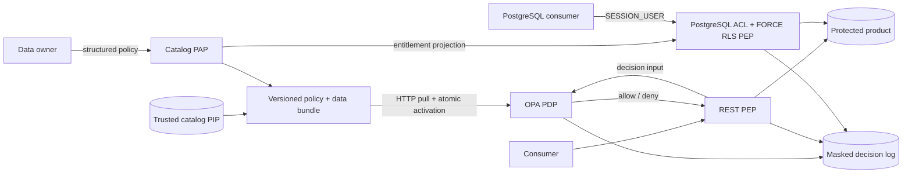
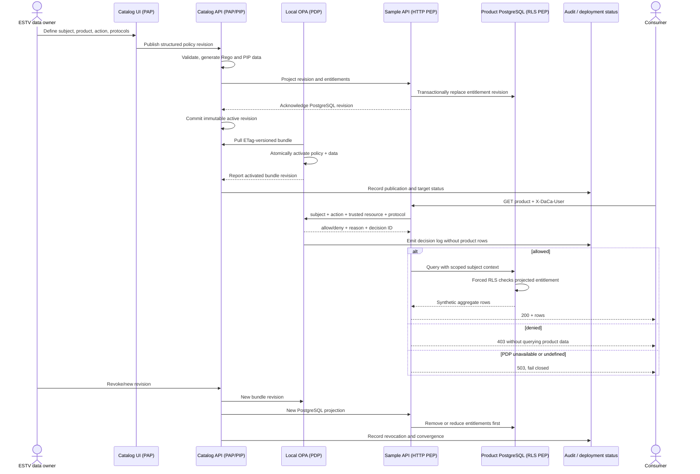

# PBAC policy flow

## Requester decision messages

The original implementation updated a request's status but created only the owner's review
task. It now also persists requester-private `information` workflow tasks for approval pending
activation, effective grant and rejection. Submission alone sends no approval message. Grant
messages are created only after the existing policy coverage and OPA/PostgreSQL convergence
checks succeed. Pending approval messages are superseded when the final decision arrives.
The owner publication notice likewise no longer claims immediate activation.

Messages link to `/products/:id/usage?request=:requestId`, resolve the exact actor-owned request,
and refresh an already-open detail view when the message feed changes. Acknowledgement uses
the existing recipient-only endpoint and leaves the request/permissions unchanged. Stable
message IDs make polling, repeated acknowledgements and restarts idempotent. Existing decisions
are reconciled on the recipient's task read; a historical grant is announced only with current
published policy coverage and both deployment confirmations. Messages contain request references
and decision/validity summaries, never protected data records or credentials.

After submitting a product-access request, the receipt identifies the current Data Owner
with portrait, organization and a Teams link. It uses the shared product/person resolver;
for a known owner the Teams recipient comes from the current directory email, rather than
a stale metadata link. Missing profiles or Teams contacts are shown explicitly. This
contact display does not approve a request or change its authorization workflow.

## Requests without a chosen end date

The access-request form offers **Unbestimmtes Enddatum** explicitly. It submits
`validUntil: null`; the database, request API, receipt and history preserve that intent.
The start date remains required. Bounded requests still require an end on/after the start,
and renewal requests remain finite extensions. The Data Owner sees the same unbounded
choice when reviewing a request. Merely submitting it creates no access rights.

Policy grants already represent no chosen expiry through the inclusive ceiling
`9999-12-31`. The request-to-policy boundary maps null to that existing representation,
so generated Rego and forced PostgreSQL RLS keep their established validity checks.
Fulfillment and deployment-acknowledgement matching use the same canonical conversion;
finite and unbounded requests cannot be confused. User-facing grant dates show
“Unbestimmtes Enddatum”. Revocation and the existing publication/convergence checks
continue to apply. The persistent nullable-column and renewal constraints are documented
in [the Catalog data model](../data-model/catalog.md).

The POC demonstrates policy-based access control for one synthetic ESTV product. The only allowed
subject is `kanton-st-gallen`; `kanton-bern`, a missing identity, an unknown protocol, and every
other combination are denied by default.

## Components

Signed-in users always see the notification bell in the blue header, including with zero
messages. Its DAAIF-style panel contains individual assigned workflow messages and open
access requests, newest first. A request and its review task produce one item/count;
request links filter Tasks to the matching product and request. The bell and panel have
localized labels and visible loading, empty and unavailable states. Escape, outside clicks
and identity changes close the panel. There is no local dismissal that could hide an
unresolved business request. Both task and inbox reads refresh every 15 seconds while
visible, on focus and on visibility changes; server authorization remains authoritative.

Normal product request review displays the request number/purpose and resolves a personal
requester against the identity directory before selection. Requested dates, protocols and
a requested modified data variant are carried into the access setting. A missing request,
a request for another product or an unresolved personal identity cannot be activated.
Backend fulfillment checks and the existing publication process remain authoritative.

The product overview provides a **Zugriff anfragen** action above its status badge for
consumers, with the same product-specific request route and responsibility guard as the
catalog context menu. The action remains usable on narrow screens with a 44px minimum
target. Submitting the existing form persists an access request and creates an
`access_request_review` workflow task assigned to the product's trusted Data Owner.
The header notification bell leads to the owner's task inbox; the owner can open the
request in access settings, approve it for policy preparation or reject it. Workflow
notifications refresh every 15 seconds while the page is visible and on window focus;
the task page reads the current request inbox when opened. Requesters can reload their
own request history to see the decision. Submission or owner approval alone does not
grant access: policy publication and matching OPA/PostgreSQL revisions remain required.

The `product-access-request` real-browser regression covers the overview action on
desktop/mobile, submission as a consumer, the correct owner's notification and inbox,
opening the review form, a persisted rejection and requester-visible history. The test
closes only its synthetic request and retains audit evidence without publishing a policy.

- **PAP** — the catalog UI and API store the structured policy, generate Rego, validate it, and
  publish an immutable revision.
- **PIP** — product ownership, classification, origin, and endpoint details come from the trusted
  catalog database and are placed in the OPA bundle. Request method/action and the development
  subject identity are supplied by the PEP.
- **PDP** — OPA evaluates `data.daca.authz.decision` locally.
- **HTTP PEP** — the sample FastAPI dependency rejects before it reads PostgreSQL.
- **PostgreSQL PEP** — ACLs plus `FORCE ROW LEVEL SECURITY` consult the projected entitlement by
  `SESSION_USER`; the service login may supply request context only for its own session.

On publication or revocation, failure to deploy the PostgreSQL projection returns `503` and
retains the previous active catalog policy; stale direct-database access is not silently presented
as converged. A revision is shown as fully deployed only after OPA and PostgreSQL acknowledge it.

## Why PostgreSQL does not call OPA per statement

PostgreSQL has no built-in transparent OPA hook for arbitrary raw SQL. OPA SQL filtering can help
a managed query layer construct predicates, but it cannot stop a raw client from reaching an
unprotected base table. This POC therefore projects the constrained policy into native
entitlements and forced RLS. A production system that requires a live OPA decision for every
connection/query would need a mandatory PostgreSQL-aware gateway or a broker issuing short-lived
credentials; that is deliberately outside this lean POC.

## Production hardening deferred from the POC

Replace the development header with validated OIDC claims; add TLS/mTLS, signed and persisted OPA
bundles, short-lived PostgreSQL identities, external secret management, revocation/session rules,
decision-log masking, and deployment monitoring. OPA input and decision logs may contain sensitive
attributes and must not be retained unfiltered.
